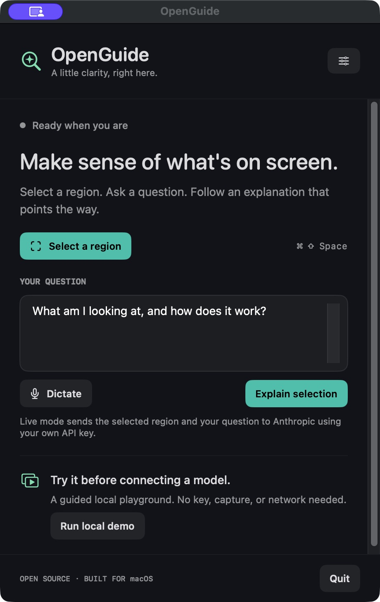

# OpenGuide

An open-source macOS companion that explains a selected part of your screen with speech and native drawings.

Built on the [MIT-licensed public Clicky foundation](https://github.com/farzaa/clicky), with an independently written drawing protocol and native MVP. Independent of HeyClicky. See [source provenance](PROVENANCE.md).



## Run on your Mac

Requires macOS 14.2 or later and Xcode 15+ / a compatible Swift 5.9+ toolchain. No third-party package dependencies.

```sh
git clone https://github.com/lostviolinist/open-guide.git
cd open-guide
./scripts/build-app.sh
open dist/OpenGuide.app
```

The app appears in the menu bar and opens its controls. Choose **Run local demo** for a spoken walkthrough with native highlights, arrows, and a hover checkpoint. The demo requires no key, network connection, or screen-recording permission. Hover inside its amber target after narration finishes to continue.

The build script creates a locally ad-hoc signed app. For a stable development signing identity, set `SIGNING_IDENTITY`; for an optimized build use `CONFIGURATION=release`. This is a development MVP, not a notarized release.

## Explain your screen

1. Open **Settings** in OpenGuide and save an Anthropic API key. It is stored in macOS Keychain. Set a model ID available to your account; the default is `claude-sonnet-4-6`.
2. Choose **Select a region**, or press **Command–Shift–Space**. Drag a rectangle on one display. Escape cancels.
3. Type a question, or choose **Dictate**, speak, and choose **Finish dictation**. On-device Apple Speech must be available for your language; typing always works.
4. Choose **Explain selection**. Allow screen recording if macOS asks; if required, quit and reopen the app after granting permission.
5. Watch and listen. If the explanation asks for a hover/click, perform it yourself; OpenGuide recaptures the selected region and continues. **Recheck** in the controls requests a new observation if an interaction is not detected.
6. Click the menu-bar icon to reopen controls and **Stop**. Completed narration remains as selectable notes until cleared or the app exits.

Live explanations send the selected region and question to Anthropic. Interaction follow-ups send a fresh capture of that same region, the original question, and the preceding explanation. Provider API usage may incur charges. OpenGuide holds images and notes in memory, uses an ephemeral HTTP session, and does not include telemetry or automatically start at login. No model-generated code is executed.

## What works in v0.1

- Menu-bar app, global selection shortcut, and per-display region selection.
- Native click-through highlights, arrows, and labels.
- Validated, bounded, versioned JSON drawing documents.
- Speech-coordinated steps and readable session notes.
- Hover dwell / physical click checkpoints, recapture, and continuation.
- Typed questions and optional on-device dictation.
- Keychain-backed API key, cancellation, timeouts, and provider error handling.
- Offline playground and automated protocol/provider tests.

## Scope and limitations

The model returns a complete document before playback; drawings do not yet stream token by token. Speech is coordinated by step rather than word timestamps. This version has no 3D, browser agent, background jobs, accessibility-tree grounding, or individually pinned cards.

Targets are tied to the selected screen region. If the underlying window moves or scrolls, stop and reselect. Display-layout changes cancel the session automatically. Interaction completion causes a new observation; it does not guarantee that the underlying UI changed.

The offline demo and mocked provider are testable without credentials. Live model quality, screen permission flows, dictation hardware, and multi-monitor behavior require testing on your Mac with your own key and permissions.

## Develop

```sh
swift test
./scripts/build-app.sh
```

The root Swift package is the active MVP. `Sources/GuideCore` defines the independent protocol; `Sources/OpenGuide` is the host. The legacy `leanring-buddy.xcodeproj`, original sources, and worker are retained as the public foundation and are not linked into the new app. Their old configuration is not needed for OpenGuide.

- [Architecture](docs/ARCHITECTURE.md)
- [Protocol v1](docs/PROTOCOL.md)
- [Validation and manual checks](docs/VALIDATION.md)
- [CI workflow example](docs/ci-workflow.example.yml) — copy into `.github/workflows/swift.yml` when enabling Actions with an appropriately scoped GitHub credential.
- [Original upstream README](docs/UPSTREAM_README.md)

MIT licensed; upstream copyright and permission notice retained in [LICENSE](LICENSE).
